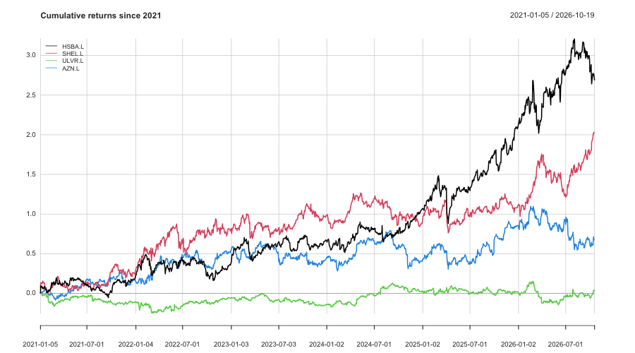

# Portfolio Risk Model (R)

A risk model for an equal-weight portfolio of four FTSE 100 stocks, built in R. It measures each stock's return and volatility, combines them into a portfolio, and estimates how much the portfolio could lose on a bad day using **Value-at-Risk (VaR)**.

**Stocks:** HSBC (HSBA.L), Shell (SHEL.L), Unilever (ULVR.L), AstraZeneca (AZN.L)
**Data:** daily adjusted closing prices from Yahoo Finance, January 2021 to October 2026
**Portfolio:** 25% in each stock, £10,000 notional value

---

## What the model does

1. **Downloads and cleans the data.** It pulls daily adjusted prices (adjusted for dividends and splits) and removes days with missing prices using `na.omit()`.
2. **Calculates returns.** It computes daily percentage returns for each stock.
3. **Measures each stock on its own.** Mean daily returns are annualised (× 252 trading days) and volatility is annualised (× √252).
4. **Builds the portfolio.** Portfolio volatility comes from the covariance matrix, using σ²ₚ = wᵀΣw, so the way the stocks move together is taken into account.
5. **Estimates 1-day 95% VaR** in two ways:
   - **Historical VaR** uses the 5th percentile of the portfolio's actual daily returns.
   - **Parametric VaR** assumes normally distributed returns: μ − 1.645σ.

---

## Results

| Measure | Value |
|---|---|
| Portfolio annual volatility | 14.2% |
| 1-day 95% VaR on £10,000 (historical) | £136.86 |
| 1-day 95% VaR on £10,000 (parametric) | £141.01 |

### Cumulative returns since 2021

